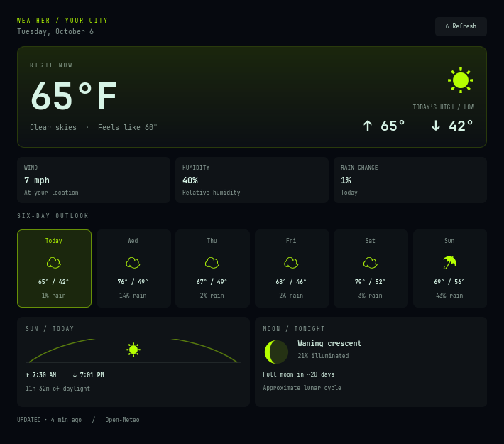

# Weather / Neil

An Omarchy weather plugin built around the question: **what is today actually going to feel like?**

Current temperature, today's full-day high and low, today plus the next five days, and a quiet sun-and-moon panel. Uses the active Omarchy palette, spacing, and typography. No radar, API key, pip packages, or separate background service.



## Features

- Current conditions, feels-like temperature, wind, and humidity.
- Today's high and low stay visible even after the warmest part of the day passes.
- Six forecast cards with highs, lows, conditions, and rain probability.
- Select a day to inspect its rain chance, sunrise, sunset, and daylight duration.
- Drawn moon phase, approximate illumination, and days until the next full moon.
- Saved forecast appears immediately while the next request runs.
- Atomic disk cache, location-specific cache validation, response limits, a 12-second request timeout, and persistent exponential retry backoff.
- Forecast dates follow the location's timezone. A seven-day response leaves room for rollover to the next local day during an outage.
- Stale readings are labeled **last known conditions** and **saved forecast**.

## Requirements

An Omarchy installation using the Quickshell plugin runtime, Python 3.9+ with system timezone data, and network access to `https://api.open-meteo.com`.

Waybar-era Omarchy installations are not supported. Omarchy shell APIs can change; this initial version was validated against the shell installed on October 6, 2026.

## Install from a checkout

```bash
./install.sh
```

The installer links the checkout into `~/.config/omarchy/plugins/neil.weather` and backs up `shell.json` before editing it. It replaces the first Linecast or built-in weather slot, or adds a center slot if neither exists. Existing radar and alert plugins remain separate.

If needed, run `omarchy restart shell` after installation. During development, `omarchy-shell shell rescanPlugins` reloads the checkout; symlinked source edits may require an explicit rescan.

Once this repository is published, it can also be installed through `omarchy plugin add <repository-url> --enable`.

## Location and units

Uses Omarchy's shared location at `~/.local/state/omarchy/settings/weather.json`. Configure a location with coordinates through Omarchy or its CLI:

```bash
omarchy weather location --set "Your city" latitude,longitude
```

Stored coordinates are required. This plugin does not silently guess your location from your IP address.

The bar entry in `~/.config/omarchy/shell.json` accepts:

```json
{"id": "neil.weather", "unit": "imperial"}
```

Set `unit` to `metric` for Celsius and km/h. Default: Fahrenheit and mph.

## Controls

- Left or right click the bar pill: open/close.
- Hover the bar pill: today's high/low and freshness.
- Middle click: force a refresh.
- Click **Refresh** in the popup: force a refresh.
- Click a forecast card or use Left/Right: select the day.
- Escape or click outside: close.
- Tab: move between Omarchy panels.

## Data and accuracy

Weather comes from [Open-Meteo](https://open-meteo.com/), using its best-match forecast models. Current conditions are modeled weather, not a personal weather-station observation. Data attribution: Open-Meteo, [CC BY 4.0](https://creativecommons.org/licenses/by/4.0/).

The moon uses a mean synodic cycle calculation anchored to January 6, 2000. Phase, illumination, and next-full-moon timing are **approximate**, and labeled accordingly. It does not provide moonrise/moonset or a precision astronomical ephemeris. Sun times are supplied by Open-Meteo.

Forecasts refresh every 15 minutes; the plugin checks once a minute for freshness, timezone rollover, and retry eligibility. The cache and retry state live in `~/.local/state/neil-weather/`, outside the repository. After an extended outage, expired forecast days disappear rather than being relabeled as today.

## Development

```bash
python3 -m unittest discover -s tests -v
qmllint -I /usr/share/omarchy/shell *.qml
```

`weather.py` handles fetching, validation, caching, and lunar estimates. `Panel.qml` handles the shell lifecycle and state. `WeatherView.qml` is the panel layout; `Metric.qml` and `WeatherText.qml` provide shared styles. There are no third-party Python dependencies.

## Uninstall

Remove `neil.weather` from your bar layout, then remove its directory or symlink under `~/.config/omarchy/plugins/`. The project checkout and shared Omarchy location remain untouched. Optionally remove `~/.local/state/neil-weather/` to clear its cache.

## License

MIT. The bar/popup integration is adapted from Omarchy; see [LICENSE](LICENSE) and [NOTICE](NOTICE).
